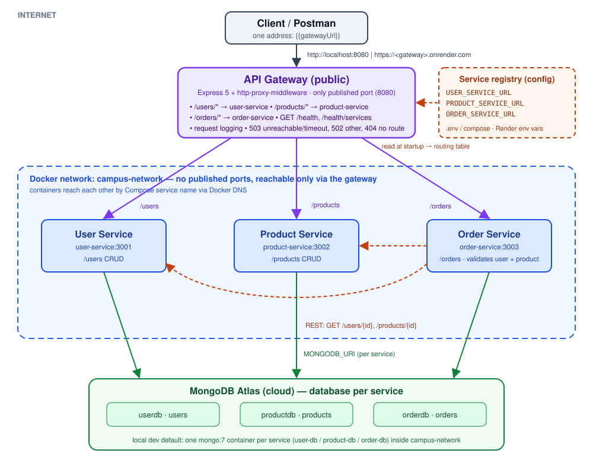
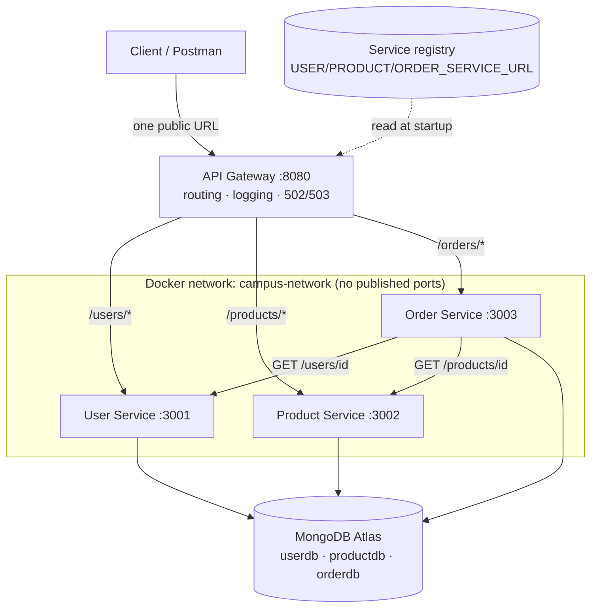

# CampusConnect Microservices (Lab 7): API Gateway, Service Discovery & Cloud Deployment

Lab 6 split the backend into three services (**User**, **Product**, **Order**) that clients called directly on ports 3001–3003. Lab 7 adds:

- **Part A:** a real **API Gateway** (`api-gateway/`), the single entry point for clients. It routes `/users`, `/products` and `/orders`, logs every request, and turns backend failures into clean 502/503 responses. Only its port is published.
- **Part B:** **configuration-based service discovery.** The gateway builds its routing table from `USER_SERVICE_URL` / `PRODUCT_SERVICE_URL` / `ORDER_SERVICE_URL`, so no host or port appears in route code.
- **Part C:** **cloud deployment on Render.** The gateway and all three services run as Docker containers, with data in MongoDB Atlas.

> **Public gateway URL:** `https://campusconnect-gateway.onrender.com` ← *replace with the URL Render shows after deploy*

The microservices themselves are unchanged from Lab 6: same resources, endpoints and status codes. Their source is identical. The only differences are in `compose.yaml` (ports no longer published, optional Atlas URI).





| Layer | Responsibility | Reachable from |
|---|---|---|
| Client / Postman | Sends every request to one address | Internet |
| API Gateway | Routes `/users`, `/products`, `/orders`; logging; error handling | Internet (public) |
| User / Product / Order | Own business logic and own data | Docker network only (locally); see §6 for Render |
| MongoDB | Persistent storage, one database per service | Services, via `MONGODB_URI` |

## 1. Project structure

```
campusconnect-microservices/
├── compose.yaml                 # gateway + 3 services + 3 local DBs; only the gateway publishes a port
├── .env.example                 # ports, the service registry, timeouts, optional Atlas URIs
├── render.yaml                  # Render Blueprint: the 4 containers + their env vars
├── api-gateway/                 # NEW in Lab 7
│   ├── Dockerfile  .dockerignore  .env.example  package.json  package-lock.json
│   ├── server.js                # /health, /health/services, proxy dispatch, 404
│   └── src/
│       ├── config/registry.js   # service registry: name -> URL, from env vars only
│       ├── config/routes.js     # routing table: path prefix -> service name
│       ├── config/gateway.js    # GATEWAY_PROXY_TIMEOUT_MS
│       ├── middleware/requestLogger.js
│       └── proxy.js             # http-proxy-middleware + centralized 502/503 handling
├── user-service/  product-service/  order-service/    # unchanged from Lab 6
├── postman/
│   ├── Microservices-Lab7-Gateway.postman_collection.json   # every request via {{gatewayUrl}}
│   ├── Lab7-Local.postman_environment.json                  # gatewayUrl = http://localhost:8080
│   ├── Lab7-Render.postman_environment.json                 # gatewayUrl = public Render URL
│   └── Microservices-Lab6.postman_collection.json           # Lab 6 (direct calls), kept for reference
└── docs/architecture-lab7.svg / .png
```

## 2. Part A: the API Gateway

The gateway is **Express 5 + `http-proxy-middleware`**, the same stack as the services. It contains **no business logic**. It never parses request bodies (`express.json()` is deliberately absent), so bodies are streamed to the backend untouched.

### Routing table

| Gateway path | Routed to | Examples |
|---|---|---|
| `GET /users`, `GET /users/{id}`, `POST /users`, `PUT/PATCH/DELETE /users/{id}` | User Service | `GET /users/101` |
| `GET /products`, `GET /products/{id}`, `POST /products`, `PUT/DELETE /products/{id}` | Product Service | `POST /products` |
| `POST /orders`, `GET /orders`, `GET /orders/{id}`, `GET /orders?userId=` | Order Service | `POST /orders` |
| `GET /health` | **Gateway itself**, no proxying | `{"service":"api-gateway","status":"UP",...}` |
| `GET /health/services` | Gateway asks each registered service for its `/health` | 200 if all UP, else 503 with per-service status |
| anything else | Gateway | 404 `{"error":"No route for GET /x"}` |

A prefix matches the path exactly or followed by `/` (`/users`, `/users/123`). `/usersx` is **not** forwarded. The full path and query string are forwarded unchanged, so `/users/123` reaches the User Service as `/users/123`. That's why every endpoint and status code from Lab 6 works as before.

### Request logging
One line per request, written when the response finishes (`src/middleware/requestLogger.js`):
```
[gateway] GET /users -> user-service (http://user-service:3001) 200 27ms
[gateway] POST /orders -> order-service (http://order-service:3003) 201 64ms
[gateway] GET /health -> gateway 200 1ms
[gateway] x user-service failed: ENOTFOUND
[gateway] GET /users -> user-service (http://user-service:3001) 503 3733ms
```
At startup it prints the routing table it built from configuration:
```
API Gateway listening on port 8080
[gateway] route /users/* -> user-service (http://user-service:3001)
[gateway] route /products/* -> product-service (http://product-service:3002)
[gateway] route /orders/* -> order-service (http://order-service:3003)
```

### Centralized error handling
All proxied routes share one error handler (`src/proxy.js`):

| Situation | Gateway returns | Body |
|---|---|---|
| Service stopped / DNS can't resolve it / connection refused or reset | **503** | `{"error":"user-service is unavailable (ENOTFOUND). Please try again later.","service":"user-service"}` |
| Service accepts the connection but doesn't answer within `GATEWAY_PROXY_TIMEOUT_MS` | **503** | `{"error":"user-service is unavailable (timed out after 10000ms). ...","service":"user-service"}` |
| Any other proxy failure | **502** | `{"error":"Bad gateway: user-service could not be proxied (...)","service":"user-service"}` |
| No route matches | **404** | `{"error":"No route for GET /x"}` |
| Backend answers (any status, including its own 400/404/503) | passed through unchanged | the backend's body |

The gateway never hangs (there's a proxy timeout) and never crashes (errors are caught per request). A downed backend affects only its own prefix: with `user-service` stopped, `/products` still returns 200.

### Only the gateway is exposed
In `compose.yaml` the three services use `expose:` instead of `ports:`. They are reachable inside `campus-network`, but nothing is published on the host:
```
NAME              STATUS                    PORTS
api-gateway       Up 16 seconds (healthy)   0.0.0.0:8080->8080/tcp
order-service     Up 15 seconds (healthy)   3003/tcp
product-service   Up 15 seconds (healthy)   3002/tcp
user-service      Up 15 seconds (healthy)   3001/tcp
order-db / product-db / user-db  (healthy)  27017/tcp
```
`curl localhost:3001/users` now fails with *connection refused*. `curl localhost:8080/users` works.

The gateway has no `depends_on` on the backends. Like the Order Service in Lab 6, it starts on its own and reports a missing backend as 503 at request time.

### Discussion: why an API Gateway instead of direct client→service calls?
- **Single entry point.** Clients know one URL (`{{gatewayUrl}}`) instead of three hosts and ports. In Lab 6 Postman needed `userBaseUrl`, `productBaseUrl` and `orderBaseUrl`; now it needs only `gatewayUrl`. Only one port or host must be public, secured with TLS, and given a DNS name.
- **Hides internal structure.** Clients don't know how many services exist, where they run, or on which ports. Services can be split, merged, moved or scaled without breaking clients, because only the gateway's routing table changes. Internal services are no longer an attack surface reachable from outside.
- **Centralizes cross-cutting concerns.** Logging, error handling (uniform 502/503 JSON), timeouts and health reporting are implemented once in the gateway instead of three times. The same place would hold authentication, rate limiting, CORS and request IDs in a production system.
- **Trade-offs:** the gateway is an extra network hop and a potential single point of failure or bottleneck. It must be kept free of business logic, and in production it would run as several replicas.

## 3. Part B: Service discovery (configuration-based)

Service locations live in exactly one place, the **service registry** (`api-gateway/src/config/registry.js`), and it only reads environment variables:

```js
module.exports = {
  'user-service': required('USER_SERVICE_URL'),
  'product-service': required('PRODUCT_SERVICE_URL'),
  'order-service': required('ORDER_SERVICE_URL')
};
```

The routing table (`src/config/routes.js`) refers to services **by name** and looks up their URL in the registry. It contains no host or port:
```js
const routeDefinitions = [
  { prefix: '/users', service: 'user-service' },
  { prefix: '/products', service: 'product-service' },
  { prefix: '/orders', service: 'order-service' }
];
```
If a variable is missing, the gateway refuses to start (`USER_SERVICE_URL environment variable is not set`) rather than guessing.

The values come from different places in each environment. The image and code are the same everywhere:

| Environment | Where the registry values come from | Example `USER_SERVICE_URL` |
|---|---|---|
| Docker Compose | `compose.yaml` ← root `.env` / shell (defaults in `.env.example`) | `http://user-service:3001` |
| `npm start` on the host | `api-gateway/.env` (copy of `.env.example`) | `http://localhost:3001` |
| Render | Render dashboard → service → Environment | `https://campusconnect-user-service.onrender.com` |

The same `USER_SERVICE_URL` / `PRODUCT_SERVICE_URL` variables are also read by the Order Service, so in Compose the gateway and Order Service share one registry.

### Proof: moving a service with configuration only
User Service moved from port 3001 to 4001 with no code change and no rebuild:
```bash
USER_SERVICE_PORT=4001 USER_SERVICE_URL=http://user-service:4001 \
  docker compose up -d user-service order-service api-gateway

docker compose logs api-gateway | grep "route /users"
# [gateway] route /users/* -> user-service (http://user-service:4001)
curl -s -o /dev/null -w "%{http_code}\n" localhost:8080/users
# 200
# [gateway] GET /users -> user-service (http://user-service:4001) 200 29ms

docker compose up -d user-service order-service api-gateway   # back to 3001 (values from .env)
```
On Render the same proof is: edit `USER_SERVICE_URL` in the gateway's Environment tab → *Save, rebuild and deploy* → the new URL appears in the gateway's startup log, and `GET /users` still works.

### Static (config) vs dynamic service discovery
This lab's registry is **static**. URLs are read once at startup, and a change means editing config and restarting the gateway. A **dynamic** registry (Consul, Eureka, etcd, Kubernetes Services/DNS) adds:

| Dynamic registry adds | Static config file cannot |
|---|---|
| **Self-registration.** Instances register on start and deregister on shutdown | Someone must edit the URL by hand for every move |
| **Health-aware routing.** The registry heartbeats or health-checks instances and stops returning dead ones | We keep routing to a dead URL and return 503 until it is fixed |
| **Multiple instances + load balancing.** One name resolves to N replicas, and the client or gateway spreads load | One URL per service, so scaling out needs an external load balancer |
| **Runtime updates without restarts.** Gateways watch the registry and pick up changes live | The gateway reads env vars only at startup |
| Ephemeral addresses (autoscaling, rescheduled containers, changing IPs) | Works only when addresses are stable (Docker DNS names, fixed cloud URLs) |

Docker's embedded DNS (`user-service` → container IP) and Render's stable `*.onrender.com` names already hide raw IPs from us. That makes a static registry practical at this scale. It stops being enough once services have several instances that come and go.

## 4. Running locally

```bash
cp .env.example .env            # first time only; defaults work as-is
docker compose up -d --build    # 7 containers; only api-gateway publishes a port (8080)
docker compose ps
curl localhost:8080/health
curl localhost:8080/health/services
docker compose logs -f api-gateway
```

To use **MongoDB Atlas** locally instead of the three mongo containers, set `USER_MONGODB_URI`, `PRODUCT_MONGODB_URI` and `ORDER_MONGODB_URI` in `.env` (see `.env.example`). `.env` is git-ignored because it then contains credentials.

### Environment variables

| Variable | Used by | Default | Purpose |
|---|---|---|---|
| `GATEWAY_PORT` | compose → api-gateway `PORT` | `8080` | The only published port |
| `USER_SERVICE_URL` | gateway, order-service | `http://user-service:3001` | Registry entry for User Service |
| `PRODUCT_SERVICE_URL` | gateway, order-service | `http://product-service:3002` | Registry entry for Product Service |
| `ORDER_SERVICE_URL` | gateway | `http://order-service:3003` | Registry entry for Order Service |
| `GATEWAY_PROXY_TIMEOUT_MS` | gateway | `10000` (Render: `120000`) | Max wait for a backend before 503 |
| `DEPENDENCY_TIMEOUT_MS` | order-service | `3000` (Render: `60000`) | Max wait for User/Product before 503 |
| `USER/PRODUCT/ORDER_SERVICE_PORT` | compose | `3001/3002/3003` | Internal container ports |
| `*_MONGODB_URI` → `MONGODB_URI` | each service | local `mongodb://<svc>-db:27017/<svc>db` | That service's own database (Atlas in the cloud) |

## 5. Postman tests

Import `postman/Microservices-Lab7-Gateway.postman_collection.json` and both environment files. **Every request uses `{{gatewayUrl}}`.** Switching between local and cloud means changing only the environment (*Lab7 - Local* ↔ *Lab7 - Render*).

| Folder | Requests | Expected |
|---|---|---|
| 00 API Gateway | `GET /health`, `GET /health/services`, `GET /does-not-exist` | 200 (`service: api-gateway`), 200 (all UP), 404 |
| 01 /users → User Service | list, create, get, PUT, invalid id, missing fields, create + delete temp | 200, 201, 200, 200, 404, 400, 201/204 |
| 02 /products → Product Service | list, create, get, PUT, invalid id | 200, 201, 200, 200, 404 |
| 03 /orders → Order Service | create (Order → User + Product), list, get, `?userId=`, invalid user/product, insufficient stock, invalid id | 201, 200, 200, 200, 404, 404, 400, 404 |
| 04 Unreachable service | `docker compose stop user-service` → `GET /users`, `POST /orders`; then `docker compose start user-service` → same two | **503** (from gateway), **503** (from order-service); then 200, 201 |

Local result for folders 00–03 (Newman, through the gateway):
```
requests 24 executed / 0 failed     assertions 38 executed / 0 failed
```
```bash
npx newman run postman/Microservices-Lab7-Gateway.postman_collection.json \
  -e postman/Lab7-Local.postman_environment.json \
  --folder "00 API Gateway" --folder "01 /users → User Service" \
  --folder "02 /products → Product Service" --folder "03 /orders → Order Service (Order → User / Product)"
# cloud: same command with -e postman/Lab7-Render.postman_environment.json
```

Unreachable-service checks from a terminal (verified):
```bash
docker compose stop user-service
curl -i localhost:8080/users       # 503 {"error":"user-service is unavailable (ENOTFOUND). ...","service":"user-service"}
curl -i localhost:8080/products    # 200: other routes unaffected
docker compose start user-service  # GET /users -> 200 again

docker compose pause user-service  # container alive but not answering
curl -i localhost:8080/users       # 503 after 10 s: "... (timed out after 10000ms) ..."
docker compose unpause user-service
```

## 6. Part C: Cloud deployment on Render

**Platform:** [Render](https://render.com), with four **Docker web services** (free plan) created from `render.yaml`. **Database:** the existing **MongoDB Atlas** cluster, one database per service (`userdb`, `productdb`, `orderdb`).

### Step 1: Prepare MongoDB Atlas
1. Atlas → **Database Access**: a database user with read/write access (or reuse the Lab 4 one).
2. Atlas → **Network Access** → *Add IP Address* → **`0.0.0.0/0`**. Render's free tier has no fixed outbound IPs.
3. Atlas → *Connect* → *Drivers*: copy the `mongodb+srv://...` string. Make three URIs that differ only in the database name:
   `.../userdb?retryWrites=true&w=majority`, `.../productdb?...`, `.../orderdb?...`

### Step 2: Push the project to GitHub
Render deploys from a Git repository. The repo root must be this folder, so `render.yaml` sits at the top level.
```bash
git init && git add . && git commit -m "Lab 7: API gateway, config-based discovery, Render deploy"
git branch -M main
git remote add origin https://github.com/<you>/campusconnect-microservices.git
git push -u origin main
```
`.env` and `node_modules` are git-ignored, so no secrets are committed.

### Step 3: Create the Blueprint
Render dashboard → **New → Blueprint** → connect the repo → Render reads `render.yaml` and lists 4 services:
`campusconnect-gateway`, `campusconnect-user-service`, `campusconnect-product-service`, `campusconnect-order-service`.

Render asks for each `sync: false` value:

| Service | Variable | Value |
|---|---|---|
| user-service | `MONGODB_URI` | Atlas URI ending in `/userdb?...` |
| product-service | `MONGODB_URI` | Atlas URI ending in `/productdb?...` |
| order-service | `MONGODB_URI` | Atlas URI ending in `/orderdb?...` |
| order-service | `USER_SERVICE_URL` | `https://campusconnect-user-service.onrender.com` |
| order-service | `PRODUCT_SERVICE_URL` | `https://campusconnect-product-service.onrender.com` |
| gateway | `USER_SERVICE_URL` | `https://campusconnect-user-service.onrender.com` |
| gateway | `PRODUCT_SERVICE_URL` | `https://campusconnect-product-service.onrender.com` |
| gateway | `ORDER_SERVICE_URL` | `https://campusconnect-order-service.onrender.com` |

`GATEWAY_PROXY_TIMEOUT_MS=120000` and `DEPENDENCY_TIMEOUT_MS=60000` are set by the Blueprint. Use `https://`, no trailing slash, no path. `PORT` is not set: Render injects its own, and every service already reads `process.env.PORT`.

Click **Apply**. Render builds each Dockerfile and starts the containers.

### Step 4: Check the real URLs (service discovery in practice)
If a name was already taken, Render appends a suffix (for example `campusconnect-user-service-a1b2.onrender.com`). Open each service in the dashboard and compare its URL with the registry values above. If one differs, fix it in **Environment** → *Save, rebuild and deploy*. That is a configuration-only change, exactly as in Part B.

Each service's **Logs** tab should show:
```
Connected to MongoDB
User Service listening on port 10000
```
and the gateway's:
```
API Gateway listening on port 10000
[gateway] route /users/* -> user-service (https://campusconnect-user-service.onrender.com)
[gateway] route /products/* -> product-service (https://campusconnect-product-service.onrender.com)
[gateway] route /orders/* -> order-service (https://campusconnect-order-service.onrender.com)
```

### Step 5: Test over the internet
```bash
GW=https://campusconnect-gateway.onrender.com
curl $GW/health                    # gateway UP
curl $GW/health/services           # wakes and checks all three; the first call can take ~1 min on free tier
curl $GW/users
```
Then in Postman, select the **Lab7 - Render** environment, set `gatewayUrl` to your real URL, and run folders 00–03 in the Collection Runner. Run `GET /health/services` first so the sleeping services are awake.

**Unreachable-service test in the cloud:** Render dashboard → `campusconnect-user-service` → *Settings* → **Suspend Web Service** → `GET {{gatewayUrl}}/users` returns **503** from the gateway. Click *Resume*, wait for it to be Live, and the request returns 200 again.

### What was deployed / limitations
| Deployed | Plan | Notes |
|---|---|---|
| campusconnect-gateway | Free web service | Public entry point |
| campusconnect-user-service | Free web service | Atlas `userdb` |
| campusconnect-product-service | Free web service | Atlas `productdb` |
| campusconnect-order-service | Free web service | Atlas `orderdb`; calls user/product |

- **Backends have public URLs on the free tier.** Render's network-isolated *private services* are paid-only, and free instances can't receive private-network traffic. The gateway therefore reaches the services through their `https://*.onrender.com` URLs, and those URLs are technically reachable directly. Locally the isolation is real (no published ports). On Render it holds by convention: clients are only given the gateway URL. **Fix on a paid plan:** change the three services to `type: pserv` in `render.yaml` and point the registry at their private `host:port`. That's again a config-only change. A free-tier alternative would be a shared secret header added by the gateway and checked by each service, but that would change the services, which this lab says to leave alone.
- **Cold starts.** Free services sleep after 15 minutes without traffic and take about 50 s to wake. The first request after idling is slow, which is why the cloud timeouts are raised to 60 s and 120 s. A cold `POST /orders` may wake three services in sequence.
- **Free-tier hours** are shared across the workspace (750 h/month). Four always-on services would exceed that, but sleeping services don't count.

## 7. Endpoints (unchanged from Lab 6, now via the gateway)

### `/users` → User Service
| Method | Path | Success | Errors |
|---|---|---|---|
| GET | `/users` | 200 | – |
| GET | `/users/{id}` | 200 | 404 |
| POST | `/users` | 201 | 400 (missing fields / duplicate email) |
| PUT | `/users/{id}` | 200 | 400, 404 |
| PATCH | `/users/{id}` | 200 | 400, 404 |
| DELETE | `/users/{id}` | 204 | 404 |

Body: `{ "name": "Ada Lovelace", "email": "ada@campus.edu", "course": "Computer Science", "semester": 3 }`

### `/products` → Product Service
| Method | Path | Success | Errors |
|---|---|---|---|
| GET | `/products` | 200 | – |
| GET | `/products/{id}` | 200 | 404 |
| POST | `/products` | 201 | 400 |
| PUT | `/products/{id}` | 200 | 400, 404 |
| DELETE | `/products/{id}` | 204 | 404 |

Body: `{ "name": "Data Structures Textbook", "description": "3rd edition", "category": "Books", "price": 45.5, "stock": 10 }`

### `/orders` → Order Service
| Method | Path | Success | Errors |
|---|---|---|---|
| POST | `/orders` | 201 | 400, 404, 502, 503 |
| GET | `/orders` (optional `?userId=`) | 200 | – |
| GET | `/orders/{id}` | 200 | 404 |

Body: `{ "userId": "<user id>", "productId": "<product id>", "quantity": 2 }`

The services' own `GET /health` endpoints are internal: Compose and Render health checks use them, and the gateway aggregates them at `/health/services`.

## 8. Evidence checklist (screenshots to capture)

| Evidence | How |
|---|---|
| Only the gateway port exposed | `docker compose ps` (only `0.0.0.0:8080->8080`), and `curl localhost:3001/users` refused |
| Gateway routes to all three services | Postman folders 01–03 against *Lab7 - Local* (Runner summary) + `docker compose logs api-gateway` |
| `GET /health` | Postman 00 *Gateway health* |
| 502/503 on unreachable service | `docker compose stop user-service` → Postman folder 04, first two requests |
| Config change without code change | the `USER_SERVICE_PORT=4001` commands in §3 + gateway log line `-> user-service (http://user-service:4001)` |
| Render deployment | Render dashboard with the 4 services *Live*; each service's Environment tab (hide the Mongo password); gateway Logs showing the routing table |
| Public URL reachable | browser or `curl https://<gateway>.onrender.com/health` |
| Postman re-run in the cloud | Collection Runner, folders 00–03, *Lab7 - Render* environment |
| Cloud 503 test | suspend user-service → `GET /users` → 503 |
| Atlas data | Atlas → Browse Collections: `userdb.users`, `productdb.products`, `orderdb.orders` |

## 9. Troubleshooting

| Problem | Cause | Resolution |
|---|---|---|
| `curl localhost:3001` refused | Intentional in Lab 7: services aren't published | Go through the gateway: `localhost:8080/users` |
| Gateway exits with `USER_SERVICE_URL environment variable is not set` | Registry value missing | Set it in `.env` (Compose), `api-gateway/.env` (npm start) or Render → Environment |
| Gateway returns 503 `ENOTFOUND` locally | Target container stopped, or wrong name in the URL | `docker compose ps`, `docker compose start <svc>`, check the URL's host is the Compose service name |
| Gateway returns 503 `ECONNREFUSED` | Right host, wrong port (e.g. `USER_SERVICE_PORT` changed but `USER_SERVICE_URL` not) | Keep the port in the URL in sync with `*_SERVICE_PORT` |
| `Bind for 0.0.0.0:8080 failed: port is already allocated` | Something else uses 8080 | `GATEWAY_PORT=8081` in `.env` |
| Lab 6 containers conflict | Both labs use Compose project `campusconnect` and the same container names | Run one lab at a time: `docker compose down` in the other folder |
| Render: gateway 503 `timed out` on first request | Free services were asleep | Call `/health/services` first, wait, retry; timeouts are already raised for Render |
| Render: gateway 503 `ENOTFOUND` | Registry URL doesn't match the URL Render actually assigned | Copy the exact URL from the service's page into the gateway's Environment |
| Render: 404 with an HTML page / wrong service answers | Registry URL has a path or trailing slash, or uses `http://` | Use exactly `https://<name>.onrender.com` |
| Render service fails with `Failed to connect to MongoDB` / `querySrv ENOTFOUND` / `bad auth` | Atlas IP allow-list, wrong password, or special characters not URL-encoded | Atlas Network Access `0.0.0.0/0`; URL-encode the password (`@` → `%40`); check the URI in Render → Environment |
| Render build fails `npm ci` lockfile error | `package-lock.json` missing or out of sync in the repo | `npm install` in that service folder, commit the lockfile |
| Orders work locally but 503 on Render | Order Service's own `USER_SERVICE_URL` / `PRODUCT_SERVICE_URL` not set to the public URLs | Set them on `campusconnect-order-service`; its log shows `-> GET https://...` |

## 10. Reflection

In Lab 6 the client had to know the system's internal layout: three hosts and ports, all reachable from outside. In Lab 7 it knows exactly one URL, and the gateway decides where each request goes. Because the backends are hidden, we can now move or re-port a service by changing one registry value instead of every client. Logging and failure handling moved to a single place: one gateway log shows every request with its target and status, and a dead backend produces the same clean 503 JSON for any route instead of a client-side connection error. Deploying to Render changed how the system is operated. It runs from a Git push and a `render.yaml` Blueprint instead of `docker compose up`, configuration lives in the platform's environment settings, and the data stays in Atlas. It also exposed real-world constraints that localhost hides: cold starts that force longer timeouts, an allow-list for the database, and the fact that "internal only" networking is a paid feature. That made the static-vs-dynamic discovery trade-off concrete rather than theoretical.
